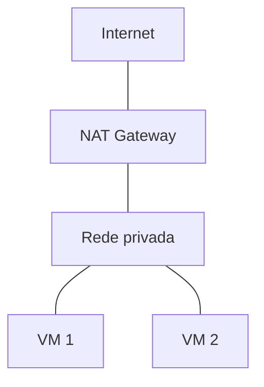

# 3. Fundamentos de Redes

## 3.1 Modelo OSI e TCP/IP

O modelo OSI descreve comunicação de rede em 7 camadas teóricas. Na prática do dia a dia de infraestrutura, o modelo TCP/IP, mais simplificado, é o que realmente orienta o raciocínio:

| Camada TCP/IP | Exemplos |
|---|---|
| Aplicação | HTTP, HTTPS, DNS, SSH |
| Transporte | TCP, UDP |
| Internet | IP, roteamento |
| Enlace/Física | Ethernet, switches, Wi-Fi |

!!! info "Contexto complementar"

    O modelo OSI (7 camadas: Física, Enlace, Rede, Transporte, Sessão, Apresentação, Aplicação) é mais usado como referência acadêmica e didática. No dia a dia de sustentação, o modelo TCP/IP de 4 camadas é o que efetivamente orienta o diagnóstico de problemas.

## 3.2 IP, IPv4 e IPv6

Um endereço IP identifica unicamente um dispositivo numa rede. O **IPv4** usa 32 bits, representado em 4 octetos decimais (ex: `192.168.1.10`), oferecendo cerca de 4,3 bilhões de endereços, número já insuficiente para a quantidade de dispositivos conectados no mundo. O **IPv6** usa 128 bits, resolvendo esse limite com um espaço de endereços praticamente inesgotável, representado em blocos hexadecimais (ex: `2001:0db8::1`).

## 3.3 Máscara de Rede, CIDR e Subnet

A notação **CIDR** (*Classless Inter-Domain Routing*) representa um bloco de endereços IP na forma `IP/prefixo`, onde o número após a barra indica quantos bits representam a parte de rede do endereço; o restante dos bits define o espaço de endereços disponíveis dentro daquela rede.

```text title="Exemplos de blocos CIDR"
10.0.0.0/16     -> até 65.536 endereços (parte da VPC inteira)
10.0.1.0/24     -> até 256 endereços (uma subnet)
192.168.1.0/24  -> até 256 endereços (rede doméstica típica)
```

Uma **subnet** é uma subdivisão lógica de uma rede maior, usada para organizar recursos em grupos com propósitos distintos (ex: uma subnet para servidores web, outra para banco de dados) e para aplicar controles de acesso diferentes a cada grupo.

!!! info "Contexto complementar"

    Em provedores de nuvem, é comum cada subnet estar associada a uma única Availability Zone (zona de disponibilidade): uma subnet não "atravessa" zonas.

## 3.4 Gateway e Roteamento

Um **gateway** é o ponto de saída de uma rede local para outras redes (incluindo a internet). Uma **tabela de rotas** (*route table*) define, para cada faixa de destino, por qual gateway o tráfego deve seguir.

## 3.5 Portas, TCP e UDP

Enquanto o IP identifica a máquina, a **porta** identifica o serviço/processo específico dentro dela.

| Porta | Serviço |
|---|---|
| 22 | SSH |
| 80 | HTTP |
| 443 | HTTPS |
| 53 | DNS |
| 3306 | MySQL |
| 5432 | PostgreSQL |

**TCP** é orientado a conexão: antes de trocar dados, faz um *handshake* de três vias (SYN → SYN-ACK → ACK), garantindo entrega confiável e ordenada. É usado onde perder dado não é aceitável: HTTP, SSH, transferência de arquivos, bancos de dados.

**UDP** não estabelece conexão prévia: simplesmente envia pacotes, sem garantia de entrega ou ordem. Isso o torna mais rápido, e por isso é usado em streaming de vídeo, chamadas de voz e consultas DNS simples, onde perder um pacote ocasional é preferível a esperar reenvio.

## 3.6 HTTP, HTTPS e TLS

**HTTP** é o protocolo de comunicação da web, baseado em requisições e respostas em texto claro. **HTTPS** é o mesmo protocolo, envolto numa camada de criptografia via **TLS** (*Transport Layer Security*), garantindo que o conteúdo trafegado não possa ser lido ou alterado por terceiros no caminho.

## 3.7 DHCP

**DHCP** (*Dynamic Host Configuration Protocol*) atribui automaticamente endereços IP a dispositivos que entram numa rede, eliminando a necessidade de configuração manual de IP em cada máquina.

## 3.8 NAT

**NAT** (*Network Address Translation*) traduz endereços IP privados para um endereço público compartilhado, permitindo que máquinas numa rede interna acessem a internet sem cada uma precisar de um IP público próprio. Em Cloud, o **NAT Gateway** cumpre esse papel para recursos em subnets privadas: eles conseguem iniciar conexões para fora, mas não recebem conexões iniciadas de fora.



Um único NAT Gateway atende múltiplas VMs privadas. As VMs iniciam conexão para fora; a internet **não** consegue iniciar conexão para dentro.

## 3.9 Firewall e Security Groups

Um **firewall** filtra tráfego de rede com base em regras (origem, destino, porta, protocolo). Em Cloud, o **Security Group** funciona como um firewall associado diretamente a um recurso (como uma instância), controlando quais conexões de entrada e saída são permitidas para aquele recurso especificamente. Isso é diferente de uma subnet, que apenas define onde o recurso está na rede e quais rotas ele possui.

!!! warning "Atenção"

    Uma instância numa subnet pública ainda pode ter todo o tráfego de entrada bloqueado se o Security Group associado a ela negar essas conexões. Subnet e Security Group atuam em camadas independentes: a subnet permite a rota, mas o Security Group decide se a conexão realmente passa.
