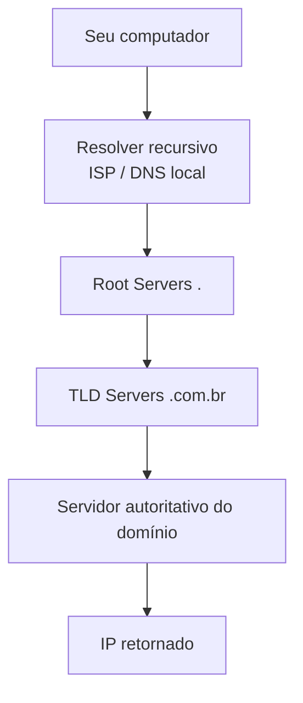

# 4. DNS

## 4.1 Resolução de Nomes

**DNS** (*Domain Name System*) traduz nomes de domínio legíveis por humanos (`exemplo.com.br`) em endereços IP que as máquinas de fato usam para se comunicar.



## 4.2 Tipos de Registro

| Registro | Função |
|---|---|
| `A` | Aponta o domínio para um endereço IPv4 |
| `AAAA` | Aponta o domínio para um endereço IPv6 |
| `CNAME` | Cria um alias, apontando para outro nome de domínio |
| `MX` | Define o(s) servidor(es) responsável(is) por e-mail do domínio |
| `TXT` | Armazena texto arbitrário, usado para validações (SPF, verificação de propriedade) |
| `NS` | Indica quais servidores são autoritativos para o domínio |

**TTL** (*Time To Live*) define por quanto tempo uma resposta DNS pode ficar em cache antes de ser consultada novamente. TTL baixo permite mudanças rápidas de propagação, à custa de mais consultas; TTL alto reduz carga nos servidores DNS, à custa de propagação mais lenta em caso de mudança.

**Recursive resolver** é o servidor que faz todo o trabalho de navegar pela hierarquia DNS em nome do cliente; **authoritative DNS** é o servidor que efetivamente detém e responde pelo registro final de um domínio específico.

## 4.3 Diagnóstico de Problemas de DNS

```bash title="Ferramentas de diagnóstico de rede e DNS"
dig exemplo.com            # consulta DNS detalhada
nslookup exemplo.com       # consulta DNS simples
host exemplo.com           # consulta DNS resumida
curl -I https://exemplo.com  # verifica resposta HTTP (cabeçalhos)
ping exemplo.com           # testa conectividade básica e latência
traceroute exemplo.com     # mostra o caminho (saltos) até o destino
ss -tulnp                  # portas abertas localmente
ip a                       # mostra interfaces de rede e IPs locais
```

!!! example "Problema comum: domínio não resolve"

    **Sintoma:** `curl` retorna erro de resolução de nome.

    **Possíveis causas:** registro DNS inexistente ou incorreto; TTL expirado sem propagação correta; resolver local com cache corrompido; firewall bloqueando porta 53.

    **Comandos:** `dig dominio.com`, `dig dominio.com @8.8.8.8` (testando um resolver externo diretamente).

    **Interpretação:** se o `dig` contra um resolver externo funciona mas o local não, o problema está no resolver/cache local, não no registro em si.
