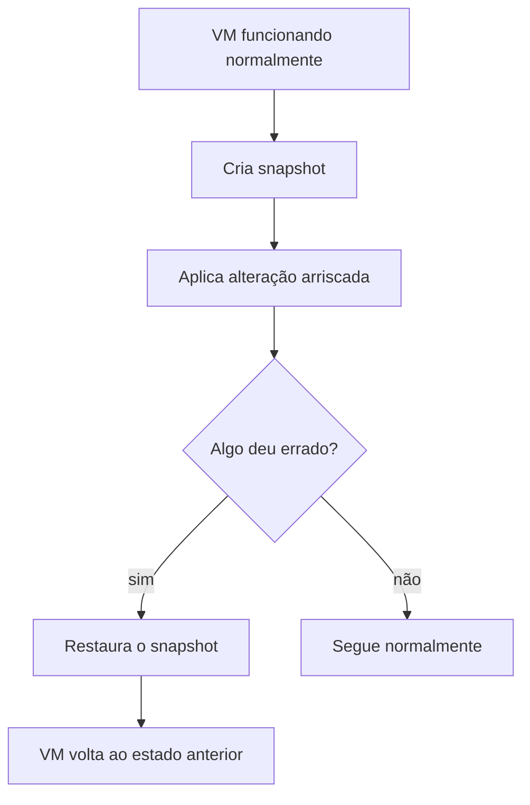

# 5. Virtualização

## 5.1 Máquinas Virtuais e Hypervisor

**Virtualização** é a técnica que permite executar múltiplos sistemas isolados (máquinas virtuais) sobre um único hardware físico. Cada VM tem sua própria CPU virtual, memória, disco e sistema operacional completo, como se fosse uma máquina física independente.

Quem gerencia essas VMs é o **hypervisor**:

| Tipo | Característica |
|---|---|
| **Tipo 1** (bare-metal) | Roda diretamente sobre o hardware, sem sistema operacional hospedeiro. Usado em produção/datacenter. Exemplos: VMware ESXi, XCP-ng, Microsoft Hyper-V. |
| **Tipo 2** (hosted) | Roda como uma aplicação sobre um sistema operacional já instalado. Usado em ambientes de desenvolvimento/teste local. Exemplo: VirtualBox. |

!!! info "Contexto complementar"

    XCP-ng é um hypervisor open-source baseado no projeto Xen, funcionando como alternativa gratuita ao VMware ESXi. É citado como diferencial em vagas de sustentação de infraestrutura, ao lado do próprio VMware.

## 5.2 Virtualização de CPU, Memória e Armazenamento

O hypervisor abstrai os recursos físicos e os distribui entre as VMs: CPU virtual (**vCPU**) mapeia para tempo de execução na CPU física; memória é alocada em blocos isolados por VM; e armazenamento é apresentado como discos virtuais, que na prática são arquivos ou volumes no storage físico subjacente.

## 5.3 Redes Virtuais

Assim como recursos de computação, a rede também é virtualizada: um **switch virtual** conecta as VMs entre si e ao mundo externo, permitindo isolamento lógico (VLANs virtuais) sem depender de cabeamento físico separado.

## 5.4 Snapshots, Templates e Provisionamento

Um **snapshot** é um ponto de restauração do estado de um disco/VM em determinado momento: permite reverter alterações problemáticas rapidamente.

Um **template** é uma imagem base pré-configurada, usada como ponto de partida para criar novas VMs rapidamente, sem repetir manualmente toda a instalação e configuração inicial.

## 5.5 Virtualização vs. Containers

É comum confundir VM com container, mas a diferença é fundamental:

| | Máquina Virtual | Container |
|---|---|---|
| Isolamento | Hardware virtualizado completo | Processos isolados, kernel compartilhado |
| Sistema operacional | Um SO completo por VM | Compartilha o kernel do host |
| Peso | Pesado (GBs) | Leve (MBs) |
| Tempo de inicialização | Minutos | Segundos |
| Isolamento de segurança | Mais forte (virtualização de hardware) | Mais fraco (isolamento lógico) |

## 5.6 Relação com Cloud Computing

A Cloud, em sua essência, é virtualização em escala massiva, orquestrada por software: quando você cria uma instância EC2 na AWS, por exemplo, você está solicitando uma VM provisionada automaticamente sobre a infraestrutura física compartilhada do provedor.

??? question "Por que uma empresa que já usa containers ainda investe em VMs?"

    Porque VMs oferecem isolamento mais forte (útil para multi-tenancy e segurança), enquanto containers priorizam eficiência e velocidade. Muitas arquiteturas modernas usam containers rodando dentro de VMs, combinando os dois níveis de isolamento.
