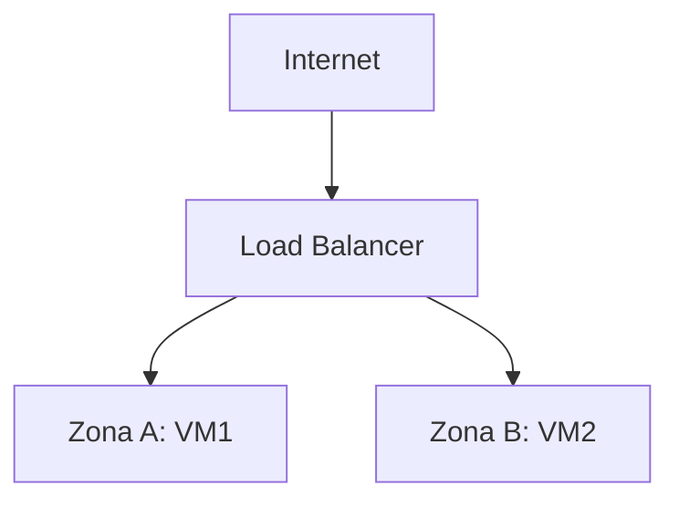

# 6. Fundamentos de Cloud

## 6.1 O que é Cloud Computing

**Cloud Computing** é a entrega de recursos computacionais (processamento, armazenamento, rede, bancos de dados, entre outros) sob demanda, via internet, com cobrança baseada em uso, sem que o cliente precise possuir ou administrar a infraestrutura física subjacente.

## 6.2 IaaS, PaaS e SaaS

| Modelo | O que o provedor entrega | O que você gerencia |
|---|---|---|
| **IaaS** | Infraestrutura bruta (VMs, rede, storage) | Sistema operacional, runtime, aplicação |
| **PaaS** | Plataforma pronta para rodar código | Apenas sua aplicação e dados |
| **SaaS** | Software completo, pronto para uso final | Apenas configuração de uso |

Exemplos: EC2 (AWS) é IaaS; um serviço gerenciado que só pede seu código, como Heroku ou AWS Elastic Beanstalk, é PaaS; Gmail ou Salesforce são SaaS.

## 6.3 Elasticidade e Escalabilidade

**Elasticidade** é a capacidade de um ambiente se ajustar automaticamente, para cima ou para baixo, conforme a demanda muda em tempo real. **Escalabilidade** é a capacidade do sistema de crescer para suportar mais carga, e se divide em duas estratégias:

- **Vertical:** aumentar os recursos de uma única máquina (mais CPU, mais RAM). Tem um teto físico, e o custo e a complexidade de continuar escalando verticalmente crescem rápido a partir de certo ponto, que varia conforme o tipo de workload.
- **Horizontal:** adicionar mais máquinas, distribuindo a carga entre elas (geralmente via um Load Balancer). Não tem o mesmo teto físico, e ainda traz redundância: se uma máquina falha, as demais continuam atendendo.

??? question "Quando escalar verticalmente ainda faz mais sentido que horizontalmente?"

    Em cargas que são difíceis de distribuir entre máquinas, como um banco de dados relacional único com muitas transações dependentes entre si: dividir isso entre várias máquinas introduz complexidade de sincronização que pode não compensar.

## 6.4 Alta Disponibilidade, Regiões e Zonas

**Região** é uma área geográfica onde o provedor mantém infraestrutura (ex: São Paulo, Virgínia do Norte). Cada região é dividida em **zonas de disponibilidade** (*Availability Zones*): datacenters fisicamente separados, com energia e conectividade independentes, mas interligados por rede de baixa latência.

Alta disponibilidade é alcançada distribuindo recursos entre múltiplas zonas: se uma zona inteira falhar, o serviço continua rodando na outra.

Se a Zona A cair por completo, o Load Balancer direciona todo o tráfego para a Zona B.

## 6.5 Fault Tolerance e Pay-as-you-go

**Fault tolerance** (tolerância a falhas) é a capacidade do sistema continuar operando, ainda que de forma degradada, mesmo diante da falha de um componente. **Pay-as-you-go** é o modelo de cobrança por uso real, sem contratos fixos de capacidade mínima obrigatória.

## 6.6 Shared Responsibility Model

O modelo de responsabilidade compartilhada define os limites entre o que o provedor de nuvem garante e o que é responsabilidade do cliente:

| Responsável | Cobre |
|---|---|
| Provedor (AWS/Azure/etc.) | Segurança física dos datacenters, hardware, virtualização, rede global |
| Cliente | Configuração de segurança (Security Groups, IAM), sistema operacional (em IaaS), dados, aplicação |

!!! warning "Atenção"

    Um erro comum de quem está começando é assumir que "está na nuvem" significa que a segurança é problema exclusivo do provedor. Na prática, a maioria dos incidentes de segurança em Cloud vem de configuração incorreta do lado do cliente: um Security Group aberto demais, credenciais expostas, um bucket de armazenamento público sem necessidade.
