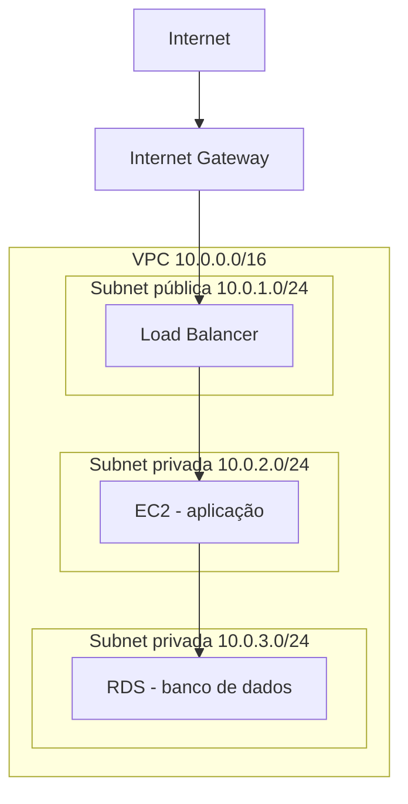
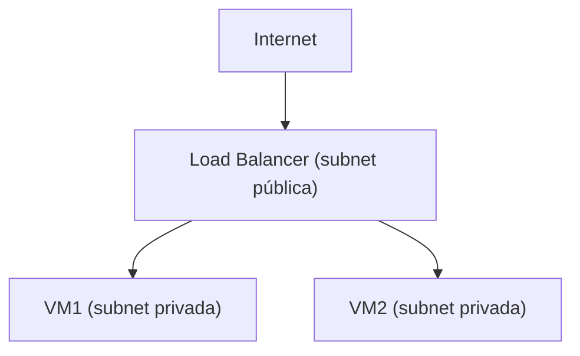

# 9. Arquitetura de uma VPC

## 9.1 Fluxo Geral

Route Tables e Security Groups controlam o que trafega entre essas camadas.

## 9.2 Public Subnet vs. Private Subnet

| | Subnet Pública | Subnet Privada |
|---|---|---|
| Rota para internet | Via Internet Gateway (entrada e saída) | Via NAT Gateway (apenas saída) |
| Recebe conexão externa | Sim, se o Security Group permitir | Não, nunca diretamente |
| Uso típico | Load Balancer, bastion host | Aplicação, banco de dados |

!!! warning "Atenção"

    Uma subnet privada não significa ausência total de internet: significa ausência de conexões iniciadas de fora para dentro. Um recurso numa subnet privada ainda pode acessar a internet para saída (baixar atualizações, chamar uma API externa) através de um NAT Gateway.

## 9.3 Route Tables

Cada subnet está associada a uma **tabela de rotas**, que determina para onde o tráfego de saída é direcionado com base no endereço de destino. Uma subnet é considerada "pública" justamente porque sua tabela de rotas contém uma rota para o Internet Gateway.

## 9.4 Isolamento entre Subnets

Mesmo dentro da mesma VPC, o tráfego entre subnets diferentes pode ser controlado e restringido via Security Groups e, de forma complementar, via **Network ACLs**: regras de firewall aplicadas no nível da subnet como um todo, e não de um recurso individual.

!!! info "Contexto complementar"

    Network ACLs (NACLs) operam de forma *stateless* (cada direção de tráfego precisa de regra explícita), enquanto Security Groups são *stateful* (uma resposta a uma conexão permitida é automaticamente aceita de volta). Essa diferença costuma aparecer em entrevistas mais avançadas de rede em Cloud.

## 9.5 Exemplo Prático: Configurando Security Groups em Camadas

!!! example "Aplicação web + banco de dados"

    Dois Security Groups separados, seguindo o princípio de menor privilégio:

    **SG da aplicação web:** libera portas 80/443 de qualquer origem (`0.0.0.0/0`); porta 22 (SSH) liberada apenas para o IP do administrador ou uma VPN.

    **SG do banco de dados:** não libera nenhuma porta para a internet. A única origem permitida na porta do banco (ex: 5432 para PostgreSQL) é o próprio Security Group da aplicação web, garantindo que só a aplicação consiga falar com o banco, mesmo que alguém descubra o IP dele.

## 9.6 Load Balancer

**O que é:** recurso que distribui requisições de entrada entre múltiplas instâncias, viabilizando escalabilidade horizontal.

**Onde fica:** tipicamente numa subnet pública, já que é o ponto de entrada do tráfego vindo da internet. As instâncias que ele distribui podem (e devem, por segurança) ficar em subnets privadas.

**Como garante alta disponibilidade:** através de *health checks* periódicos. Se uma instância para de responder, o Load Balancer deixa de enviar tráfego para ela automaticamente, redirecionando tudo para as instâncias saudáveis restantes, até que ela volte a responder normalmente.
