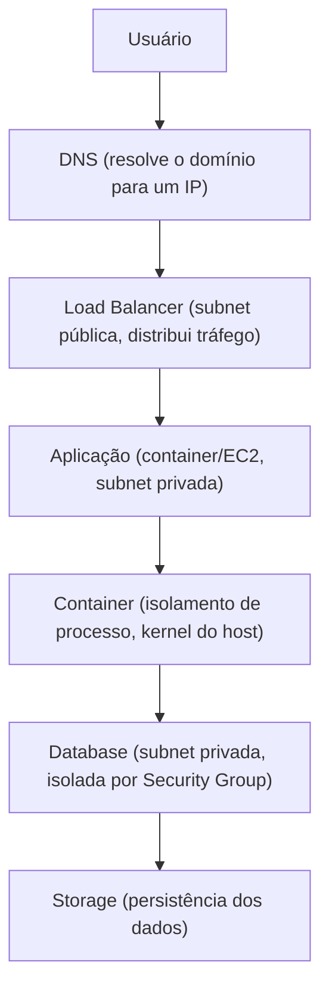

# 18. Conectando Todos os Conceitos

Uma requisição real, do clique do usuário até o dado sendo retornado, atravessa praticamente todas as camadas estudadas neste handbook:

Cada camada carrega os conceitos das partes anteriores: o DNS resolve o nome do serviço; o Load Balancer decide para qual instância a requisição vai, com base em health checks; a aplicação roda sobre um sistema operacional Linux, possivelmente dentro de um container, comunicando-se com o banco de dados através de regras definidas em Security Groups; e tudo isso é provisionado de forma consistente via Infrastructure as Code, monitorado por ferramentas de observabilidade, e mantido operacional pela mentalidade de sustentação descrita no [capítulo 16](16-sustentacao.md).

??? question "Se o usuário reporta que a página não carrega, em qual ordem você verificaria as camadas desse diagrama?"

    De fora para dentro: primeiro DNS (o nome resolve?), depois Load Balancer/rede (a porta responde?), depois aplicação (o processo está rodando, sem erro nos logs?), só então banco de dados. Isso evita perder tempo investigando o banco quando o problema real é, por exemplo, DNS não resolvendo.
